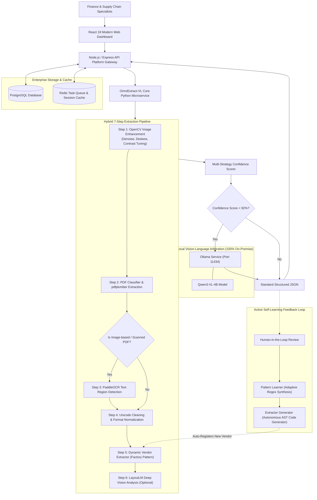

# OmniExtract-VL 🚀
### Next-Generation Autonomous Vision-Language Agent & Self-Learning Pipeline for Complex Document & Purchase Order Extraction

[](https://www.python.org/downloads/)
[](https://react.dev/)
[](https://www.typescriptlang.org/)
[](https://ollama.com/)
[](LICENSE)
[](#-privacy--enterprise-security)

🌐 **Languages**:  
[English (US)](./README.en.md) | [繁體中文 (台灣)](./README.zh-TW.md) | [日本語](./README.ja.md) | [한국어](./README.ko.md)

---

## 💡 Why OmniExtract-VL?

Enterprises process thousands of heterogeneous Purchase Orders (POs), invoices, and supply chain contracts every day. Conventional approaches face two major pain points:
1. **Traditional Rule-based OCR**: Extremely brittle. Slight layout shifts, skew, noise, or scanned artifacts easily break extraction logic.
2. **Pure Cloud LLM Extraction**: Exorbitant API inference costs, sluggish throughput, and fatal privacy risks caused by streaming sensitive financial pricing and vendor contracts to third-party clouds.

**OmniExtract-VL** solves this dilemma with a pioneering **Hybrid 7-Step Pipeline + Local Vision-Language (Qwen-VL) Arbitration + Closed-Loop Active Self-Learning** architecture:
- ⚡ **Ultra-Fast & Cost-Free**: 90%+ of standard digital PDFs are extracted in 1~2 seconds using high-precision heuristic algorithms.
- 👁️ **On-Premise Vision-Language Arbitration**: Qwen-VL only steps in when field confidence dips below 92% or when cross-page ambiguities occur—slashing GPU usage by 80% while upholding 99%+ accuracy.
- 🧠 **Autonomous Code Generation**: Every manual correction automatically distills regex patterns into the knowledge base. Once 3+ samples of a new vendor format are gathered, **the system autonomously writes and registers a dedicated Python Extractor**!

---

## 🏛️ System Architecture



---

## 🌟 Key Features

### 1. Dual-Track Hybrid Extraction
- **Vector / Digital PDFs**: Native text coordinates and tabular boundaries are extracted directly via `pdfplumber` in under 0.5 seconds per page.
- **Scanned Image PDFs**: Automatically preprocessed with OpenCV (adaptive binarization, Hough-transform deskewing, NL-means denoising) and fed into `PaddleOCR`.

### 2. Selective Multi-Modal Vision-Language Arbitration
- Powered by a local **Ollama** server running `Qwen3-VL-4B-Instruct`.
- Only triggered for low-confidence or conflicting fields, delivering cloud-grade intelligence with zero latency overhead on standard documents.
- Provides visual reasoning and dynamic feedback to tune OpenCV contrast and threshold parameters.

### 3. Active Learning & Autonomous Extractor Code Generation
- Automatically tracks differences between raw extraction and human-verified ground truth.
- Generates high-confidence regex rules on the fly.
- When $\ge 3$ corrected samples of a newly discovered vendor are accumulated, the `ExtractorGenerator` produces production-ready Python extractor code and mounts it into `ExtractorRegistry`.

### 4. Enterprise-Grade Security & Audit Stack
- **Web UI**: Built with React 18, Vite, Tailwind CSS, featuring side-by-side visual PDF comparison and financial reconciliation views.
- **Backend**: Express + TypeScript + PostgreSQL + Redis, supporting multi-tenancy, RBAC roles, and millisecond-level audit logging.
- **100% Air-Gapped Ready**: Model inference and document storage never touch external networks.

---

## 📋 Sample Structured Output

> *Note: Vendor names, addresses, and part numbers below are anonymized synthetic data.*

```json
{
  "vendor_id": "apex_global",
  "purchase_info": {
    "po_number": "PO-2026-880194",
    "order_date": "2026-03-15",
    "buyer": "Apex Global Technologies Ltd.",
    "currency": "USD",
    "payment_terms": "Net 30 Days via Wire Transfer",
    "total_amount": 1659371.65
  },
  "seller_info": {
    "vendor_code": "V-200118",
    "company_name": "Vertex Semiconductor Co., Ltd.",
    "address": "100 Innovation Way, Tech Valley, CA 94016",
    "contact_phone": "+1 (555) 019-2834"
  },
  "line_items": [
    {
      "item_no": "10",
      "part_number": "VS-43TR-16512-BL",
      "description": "High-Performance DDR3L DRAM Module 8Gb",
      "quantity": 50000,
      "unit_price": 2.15,
      "amount": 107500.00,
      "delivery_date": "2026-04-20"
    }
  ],
  "confidence_score": 0.985,
  "qwen_audit_status": "✅ HIGH_CONFIDENCE"
}
```

---

## 🚀 Quick Start

### Prerequisites
- **Docker** $\ge$ 24.x & **Docker Compose** $\ge$ 2.x
- **Python** $\ge$ 3.10 (Local development)
- **Node.js** $\ge$ 20.x LTS (Local development)
- **Ollama** (Optional, for Vision-Language arbitration)

---

### Method 1: Docker Compose (Recommended)

```bash
# 1. Clone the repository
git clone https://github.com/your-org/OmniExtract-VL.git
cd OmniExtract-VL

# 2. Setup environment variables
cp .env.example .env

# 3. Launch full stack with Docker Compose
docker compose up -d

# 4. Access services in browser:
# Frontend Dashboard: http://localhost:3000
# Backend REST API:   http://localhost:3001
# Python OCR Engine:  http://localhost:5000
```

---

### Method 2: Local Python Engine Execution

#### Step 1: Start Ollama & Download Vision Model (Optional)
```bash
ollama serve
ollama pull adelnazmy2002/Qwen3-VL-4B-Instruct:Q4_K_M
```

#### Step 2: Run Python Extraction Service
```bash
cd python_engine
pip install -r requirements.txt
python -m po_extractor.webapp
```
Open `http://127.0.0.1:5000` to upload documents, review visual highlighting, and trigger self-learning.

---

## 🔒 Privacy & Enterprise Security

OmniExtract-VL is built from the ground up for strict regulatory compliance:
- **Zero Third-Party API Calls**: Completely functional in air-gapped on-premise environments.
- **Strict Leakage Prevention**: Built-in `.gitignore` rules prevent accidental commits of real PDF contracts, customer manifests, or internal audit logs.
- **Full Operational Audit Trail**: Every transaction is logged with timestamps, user identities, validation flags, and token metrics.

---

## 🗺️ Roadmap

- [x] 7-Step Hybrid Pipeline (OpenCV + pdfplumber + PaddleOCR)
- [x] Local Ollama Qwen-VL arbitration integration
- [x] Active self-learning regex loop & autonomous extractor code generation
- [x] React 18 + Node.js enterprise portal
- [ ] Excel / Spreadsheet multi-sheet financial balance reconciliation
- [ ] Quantized multi-modal model support (GGML / INT4 on edge devices)
- [ ] Native connectors for SAP and Oracle ERP

---

## 🤝 Contributing

Contributions from the open-source community are warmly welcomed! Please read [CONTRIBUTING.md](./CONTRIBUTING.md) to get started.

## 📄 License

This project is licensed under the [MIT License](./LICENSE).

