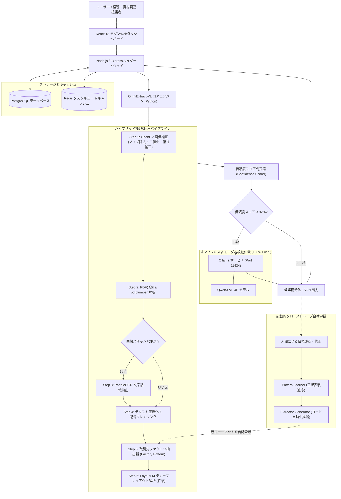

# OmniExtract-VL 🚀
### 次世代マルチモーダル・ビジョン言語モデル（Vision-Language）搭載 自律型ドキュメント・発注書（PO）抽出プラットフォーム
**Next-Generation Autonomous Vision-Language Agent & Self-Learning Pipeline for Document Extraction**

[](https://www.python.org/downloads/)
[](https://react.dev/)
[](https://www.typescriptlang.org/)
[](https://ollama.com/)
[](LICENSE)
[](#-プライバシーとエンタープライズセキュリティ)

🌐 **多言語対応 (Languages)**:  
[English (US)](./README.en.md) | [繁體中文 (台灣)](./README.zh-TW.md) | [日本語](./README.ja.md) | [한국어](./README.ko.md)

---

## 💡 なぜ OmniExtract-VL なのか？

企業のサプライチェーン、経理突合、および ERP 自動化において、取引先ごとに異なるフォーマットの発注書（Purchase Order, PO）、請求書、仕様書を処理することは極めて大きな課題です。従来の技術には以下の2つのボトルネックが存在します：
1. **従来型ルールベース OCR**：レイアウト変更に弱く、文字の傾き、ノイズ、半角・全角混在、またはスキャン画像に対して認識率が急激に低下します。
2. **純粋なクラウド LLM 抽出**：API コストが膨大で処理速度が遅く、機密性の高い単価、品目番号、取引先契約情報をクラウドへ送信するため、セキュリティ規程に違反するリスクがあります。

**OmniExtract-VL** は、**「ハイブリッド7段階処理パイプライン + ローカルビジョン言語モデル（Qwen-VL）仲裁 + 能動的自律学習」**を融合した画期的なアーキテクチャを提供します：
- ⚡ **超高速＆ゼロAPIコスト**：90%以上の標準テキスト型 PDF をアルゴリズムにより1〜2秒以内で超高速抽出。
- 👁️ **ローカルマルチモーダル仲裁**：フィールドの信頼度スコアが 92% 未満、または曖昧な場合のみローカルの **Qwen-VL** を呼び出し視覚的に判定。計算リソースを80%削減しながら 99% 以上の高精度を維持。
- 🧠 **コード自動生成による自律学習**：人間による一度の修正から正規表現を自動学習。同一ベンダーの修正サンプルが3件蓄積されると、**システムが自動で専用の Python 抽出プログラムを記述・登録**します！

---

## 🏛️ システムアーキテクチャ (System Architecture)



---

## 🌟 主な特徴 (Key Features)

### 1. デュアルトラック・ハイブリッド抽出
- **デジタル PDF (テキスト型)**：`pdfplumber` を用いて文字座標とテーブル罫線を直接取得。1ページあたり 0.5 秒未満で高速処理。
- **スキャン画像 PDF**：`OpenCV` で非局所平均フィルタによるノイズ除去、ハフ変換による傾き補正、コントラスト強調を行い、`PaddleOCR` で文字認識。

### 2. ローカルマルチモーダル仲裁（Qwen-VL）
- ローカル環境の **Ollama** で稼働する `Qwen3-VL-4B-Instruct` を統合。
- 信頼度が低い項目に限定してトリガーされるため、推論レイテンシとマシン負荷を最小化。視覚的根拠を提示し、画像前処理パラメータへのフィードバックも実施。

### 3. 能動的学習と抽出プログラムの自動生成
- 抽出結果と人間による修正データの差分を自動解析。
- 新規取引先フォーマットのサンプルが3件集まると、システムが AST テンプレートに基づき新しい `<vendor>.py` を自動出力し、エンジンに即座に組み込みます。

### 4. エンタープライズ向けセキュア設計
- **フロントエンド**：React 18、Tailwind CSS、PDF原本と抽出結果の左右分割比較ビューアを搭載。
- **バックエンド**：Express + TypeScript + PostgreSQL + Redis、ロールベースアクセス制御（RBAC）および監査ログを標準装備。
- **完全オンプレミス動作**：外部インターネット接続なし（Air-Gapped環境）で完全動作可能。

---

## 📋 抽出結果サンプル (Sample JSON)

> *※下記の取引先名、住所、型番などは匿名化されたダミーデータです。*

```json
{
  "vendor_id": "apex_global",
  "purchase_info": {
    "po_number": "PO-2026-880194",
    "order_date": "2026-03-15",
    "buyer": "Apex Global Technologies Ltd.",
    "currency": "USD",
    "payment_terms": "Net 30 Days via Wire Transfer",
    "total_amount": 1659371.65
  },
  "seller_info": {
    "vendor_code": "V-200118",
    "company_name": "Vertex Semiconductor Co., Ltd.",
    "address": "100 Innovation Way, Tech Valley, CA 94016",
    "contact_phone": "+1 (555) 019-2834"
  },
  "line_items": [
    {
      "item_no": "10",
      "part_number": "VS-43TR-16512-BL",
      "description": "High-Performance DDR3L DRAM Module 8Gb",
      "quantity": 50000,
      "unit_price": 2.15,
      "amount": 107500.00,
      "delivery_date": "2026-04-20"
    }
  ],
  "confidence_score": 0.985,
  "qwen_audit_status": "✅ HIGH_CONFIDENCE"
}
```

---

## 🚀 クイックスタート (Quick Start)

### 必要要件
- **Docker** $\ge$ 24.x & **Docker Compose** $\ge$ 2.x
- **Python** $\ge$ 3.10
- **Node.js** $\ge$ 20.x LTS
- **Ollama**（ビジョン大モデル機能を利用する場合）

---

### 方法1：Docker Compose による一括起動（推奨）

```bash
# 1. リポジトリをクローン
git clone https://github.com/your-org/OmniExtract-VL.git
cd OmniExtract-VL

# 2. 環境変数ファイルの設定
cp .env.example .env

# 3. コンテナの一括起動
docker compose up -d

# 4. ブラウザからアクセス
# 管理ダッシュボード: http://localhost:3000
# バックエンド API:   http://localhost:3001
# OCR 微サービス:    http://localhost:5000
```

---

### 方法2：ローカル Python エンジンの直接起動

```bash
# 1. Ollama の起動とモデルダウンロード (任意)
ollama serve
ollama pull adelnazmy2002/Qwen3-VL-4B-Instruct:Q4_K_M

# 2. Python 抽出エンジンの起動
cd python_engine
pip install -r requirements.txt
python -m po_extractor.webapp
```
`http://127.0.0.1:5000` を開くことで、ファイルのアップロードと抽出結果の確認が可能です。

---

## 🔒 プライバシーとエンタープライズセキュリティ

- **外部データ送信ゼロ**：すべての OCR 処理および大規模言語モデル推論をローカル環境内で完結。
- **情報漏洩防止ガード**：テスト PDF、手動修正データセット、内部作業ログは `.gitignore` によりコミット対象から厳格に除外。
- **完全な監査証跡**：ユーザーの操作履歴、処理ミリ秒、トークン使用量を記録。

---

## 📄 ライセンス (License)

本プロジェクトは [MIT License](./LICENSE) のもとで公開されています。

