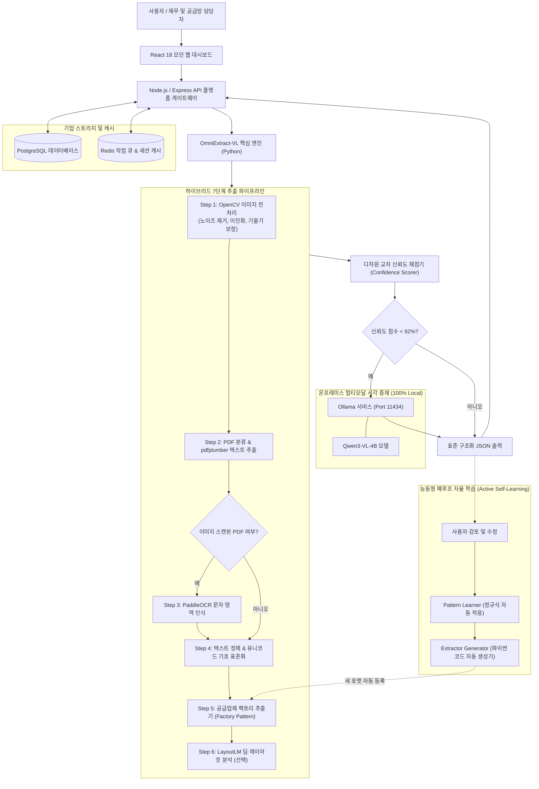

# OmniExtract-VL 🚀
### 차세대 멀티모달 비전 언어 모델 (Vision-Language) 탑재 자율형 문서 및 발주서(PO) 추출 플랫폼
**Next-Generation Autonomous Vision-Language Agent & Self-Learning Pipeline for Document Extraction**

[](https://www.python.org/downloads/)
[](https://react.dev/)
[](https://www.typescriptlang.org/)
[](https://ollama.com/)
[](LICENSE)
[](#-개인정보-보호-및-엔터프라이즈-보안)

🌐 **다국어 문서 (Languages)**:  
[English (US)](./README.en.md) | [繁體中文 (台灣)](./README.zh-TW.md) | [日本語](./README.ja.md) | [한국어](./README.ko.md)

---

## 💡 왜 OmniExtract-VL을 선택해야 하는가?

기업의 공급망 관리, 재무 대사 및 ERP 자동화 과정에서 거래처마다 서로 다른 수많은 발주서(Purchase Order, PO), 청구서 및 견적서를 처리하는 것은 큰 과제입니다. 기존 솔루션에는 다음과 같은 치명적인 한계가 존재합니다:
1. **기존 규칙 기반 OCR**: 레이아웃이 조금만 변경되거나 기울기, 노이즈, 스캔 상태에 따라 인식률이 급격히 저하되며 유지보수 비용이 과다합니다.
2. **순수 클라우드 LLM 추출**: 대량 처리 시 과도한 API 비용과 느린 속도가 발생하며, 단가 및 계약 정보 등 민감한 기업 데이터가 외부 클라우드로 전송되어 보안 규정을 위반할 위험이 있습니다.

**OmniExtract-VL**은 **「하이브리드 7단계 파이프라인 + 로컬 비전 언어 모델(Qwen-VL) 중재 + 능동형 폐루프 자율 학습」**을 결합한 혁신적인 아키텍처를 제시합니다:
- ⚡ **초고속 & 무비용 처리**: 표준 디지털 PDF의 90% 이상을 알고리즘을 통해 1~2초 이내에 초고속으로 구조화 추출합니다.
- 👁️ **로컬 멀티모달 중재**: 필드 신뢰도 점수가 92% 미만이거나 모호한 경우에만 로컬의 **Qwen-VL** 모델을 선택적으로 호출하여 시각적으로 검증, 컴퓨팅 리소스를 80% 절감하면서 99% 이상의 정확도를 유지합니다.
- 🧠 **자율 코드 생성 기반 자가 학습**: 관리자가 한 번 수정한 내역에서 정규식을 자동 추출하며, 신규 거래처 샘플이 3건 이상 누적되면 **시스템이 스스로 전용 파이썬 추출기 코드를 작성하고 등록**합니다!

---

## 🏛️ 시스템 아키텍처 (System Architecture)



---

## 🌟 주요 기능 (Key Features)

### 1. 듀얼 트랙 하이브리드 추출
- **디지털 텍스트 PDF**: `pdfplumber`를 활용하여 원본 표의 경계와 텍스트 좌표를 직접 추출, 페이지당 0.5초 이내의 초고속 처리 속도를 구현합니다.
- **스캔 이미지 PDF**: `OpenCV`를 통해 노이즈 제거, 허프 변환 기울기 보정 및 적응형 대비 향상을 수행한 후 `PaddleOCR`을 호출하여 정확도를 극대화합니다.

### 2. 로컬 비전 언어 모델(Qwen-VL)의 정밀 중재
- 로컬 **Ollama** 서버에서 실행되는 `Qwen3-VL-4B` 멀티모달 비전 모델과 통합되어 있습니다.
- 신뢰도가 낮은 필드에만 선택적으로 개입하므로 대규모 모델의 과도한 리소스 소모를 방지하며, 이미지 전처리 파라미터 개선을 위한 피드백도 제공합니다.

### 3. 능동형 자가 학습 및 추출기 코드 자동 생성
- 관리자의 수작업 수정 결과와 원본 추출 결과의 차이점을 분석하여 지식 베이스를 지속적으로 고도화합니다.
- 특정 신규 양식의 교정 데이터가 **3건** 누적되면 AST 템플릿 기반으로 새로운 `<vendor>.py` 추출기 코드를 자동 생성하여 즉시 파이프라인에 반영합니다.

### 4. 엔터프라이즈 보안 및 감사 인프라
- **프론트엔드**: React 18, Vite, Tailwind CSS 기반으로 원본 PDF와 추출 데이터의 분할 비교 뷰어 및 재무 대사 기능을 제공합니다.
- **백엔드**: Express + TypeScript + PostgreSQL + Redis 기반으로 역할 기반 권한 제어(RBAC) 및 밀리초 단위 감사 로그를 제공합니다.
- **100% 온프레미스 폐쇄망 보장**: 모든 모델 추론과 파일 처리가 사내 인프라 내부에서 완결되므로 데이터 유출 위험이 전혀 없습니다.

---

## 📋 추출 결과 샘플 (Sample Output)

> *참고: 아래의 거래처명, 주소, 품번 등은 비식별화 처리된 가상 데이터입니다.*

```json
{
  "vendor_id": "apex_global",
  "purchase_info": {
    "po_number": "PO-2026-880194",
    "order_date": "2026-03-15",
    "buyer": "Apex Global Technologies Ltd.",
    "currency": "USD",
    "payment_terms": "Net 30 Days via Wire Transfer",
    "total_amount": 1659371.65
  },
  "seller_info": {
    "vendor_code": "V-200118",
    "company_name": "Vertex Semiconductor Co., Ltd.",
    "address": "100 Innovation Way, Tech Valley, CA 94016",
    "contact_phone": "+1 (555) 019-2834"
  },
  "line_items": [
    {
      "item_no": "10",
      "part_number": "VS-43TR-16512-BL",
      "description": "High-Performance DDR3L DRAM Module 8Gb",
      "quantity": 50000,
      "unit_price": 2.15,
      "amount": 107500.00,
      "delivery_date": "2026-04-20"
    }
  ],
  "confidence_score": 0.985,
  "qwen_audit_status": "✅ HIGH_CONFIDENCE"
}
```

---

## 🚀 빠른 시작 (Quick Start)

### 사전 요구사항
- **Docker** $\ge$ 24.x & **Docker Compose** $\ge$ 2.x
- **Python** $\ge$ 3.10
- **Node.js** $\ge$ 20.x LTS
- **Ollama** (비전 대규모 모델 기능 활용 시)

---

### 방법 1: Docker Compose 원클릭 실행 (권장)

```bash
# 1. 저장소 복제
git clone https://github.com/your-org/OmniExtract-VL.git
cd OmniExtract-VL

# 2. 환경변수 파일 설정
cp .env.example .env

# 3. 서비스 실행
docker compose up -d

# 4. 브라우저 접속
# 프론트엔드 대시보드: http://localhost:3000
# 백엔드 API:         http://localhost:3001
# OCR 마이크로서비스:  http://localhost:5000
```

---

### 방법 2: 로컬 파이썬 엔진 직접 실행

```bash
# 1. Ollama 실행 및 비전 모델 다운로드 (선택)
ollama serve
ollama pull adelnazmy2002/Qwen3-VL-4B-Instruct:Q4_K_M

# 2. 파이썬 엔진 실행
cd python_engine
pip install -r requirements.txt
python -m po_extractor.webapp
```
브라우저에서 `http://127.0.0.1:5000`으로 접속하여 문서를 업로드하고 추출 결과를 확인할 수 있습니다.

---

## 🔒 개인정보 보호 및 엔터프라이즈 보안

- **외부 데이터 전송 완전 차단**: 네트워크가 격리된 사내 폐쇄망(Air-Gapped) 환경에서도 100% 정상 작동합니다.
- **민감 데이터 유출 원천 방지**: 실제 PDF 계약서, 교정 데이터 및 내부 업무 로그는 `.gitignore`를 통해 Git 추적 대상에서 완전히 제외됩니다.
- **전 구간 감사 로그**: 각 작업의 사용자 ID, 실행 밀리초, 검증 상태 및 토큰 사용량이 체계적으로 기록됩니다.

---

## 📄 라이선스 (License)

본 프로젝트는 [MIT License](./LICENSE) 하에 오픈소스로 제공됩니다.

