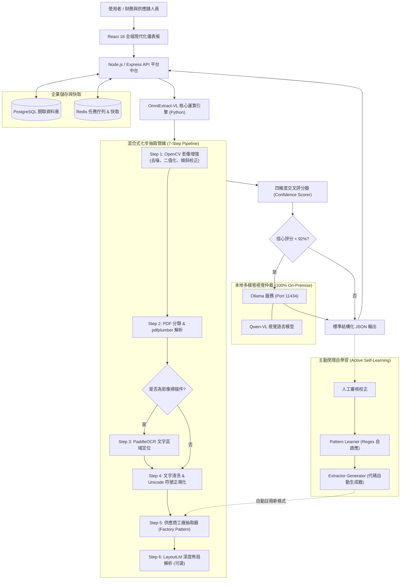

# OmniExtract-VL 🚀
### 次世代多模態視覺大模型 (Vision-Language) 自學習智慧文件與採購訂單抽取中台
**Next-Generation Autonomous Vision-Language Agent & Self-Learning Pipeline for Document Extraction**

[](https://www.python.org/downloads/)
[](https://react.dev/)
[](https://www.typescriptlang.org/)
[](https://ollama.com/)
[](LICENSE)
[](#-隱私與企業級資料安全)

🌐 **多語言文檔 (Languages)**:  
[English (US)](./README.en.md) | [繁體中文 (台灣)](./README.zh-TW.md) | [日本語](./README.ja.md) | [한국어](./README.ko.md)

---

## 💡 為什麼選擇 OmniExtract-VL？

在企業供應鏈、財務對帳與 ERP 自動化中，各家客戶發來的採購訂單（Purchase Order, PO）、發票與規格書格式成百上千。傳統技術面臨兩大困境：
1. **傳統規則式 OCR**：格式一變就失效，維護成本極高；遇到傾斜、噪點、全形半形混用或掃描件時準確率驟降。
2. **純雲端大模型抽取**：成本昂貴、處理速度慢，且將高度機密的價格、料號與供應商合約傳輸至雲端，違反企業資安法規。

**OmniExtract-VL** 提出全新的**「混合式七步處理管線 (7-Step Pipeline) + 本地視覺大模型仲裁 + 主動閉環自學習」**架構：
- **極速輕量**：90% 的標準文字型 PDF 在 1~2 秒內透過演算法極速抽取完畢。
- **視覺仲裁**：僅在欄位置信度低於 92% 或歧義時，自動呼叫本地運行的 **Qwen-VL** 進行視覺定位與裁判，大幅節省算力並維持 99%+ 準確率。
- **自學習代碼生成**：人工修正一次即自動提取 Regex 規則；新格式累積 $\ge 3$ 份樣本後，**系統自動撰寫並註冊全新的 Python Extractor 程式碼**！

---

## 🏛️ 核心系統架構 (System Architecture)



---

## 🌟 核心特色 (Key Features)

### 1. 視覺與向量雙軌解析 (Hybrid Dual-Track OCR)
- **文字型向量 PDF**：利用 `pdfplumber` 直接精準抓取座標與文字流，保留原始表格邊界，單頁解析時間 < 0.5 秒。
- **掃描型影像 PDF**：透過 `OpenCV` 自動執行高斯濾波去噪、霍夫變換傾斜校正與自適應對比度增強，再呼叫 `PaddleOCR` 進行多語言文字辨識。

### 2. 本地視覺多模態仲裁 (Local Vision-Language Arbitration)
- 整合本地 **Ollama** 運行的 `Qwen3-VL-4B` 多模態模型。
- **自適應觸發機制**：預設僅在信心評分低於 92% 或跨頁欄位出現歧義時介入，避免大模型全量運行的算力浪費。
- 視覺審核後回傳修正值與理由，並可向 OpenCV 提供動態對比度調整的反向建議。

### 3. 主動式自學習與 Extractor 自動代碼生成
- 當操作人員在前端對抽取結果進行手動微調後，系統將差異自動記錄。
- `Pattern Learner` 會自動從差異中淬鍊出新的正則表達式並寫入知識庫。
- 當同一新型供應商累積達 **3 份樣本**，系統會透過 AST 模板自動生成專屬的 `<vendor>.py` 抽取器，實現系統自主擴充。

### 4. 企業級安全中台架構
- 前端採用 **React 18 + TypeScript + Tailwind CSS**，內建雙欄比對檢視器、財務報表看板與審計日誌。
- 後端採用 **Node.js + Express + PostgreSQL + Redis**，支援多租戶、RBAC 權限控管與毫秒級操作稽核。
- **100% 地端部署保證**：所有模型推理、影像處理與資料庫讀寫均於內部網路完成，零機密外洩風險。

---

## 📋 範例：抽取結構化結果 (Sample Output)

> *註：以下範例公司名稱、地址、料號均為去敏化之虛擬數據。*

```json
{
  "vendor_id": "apex_global",
  "purchase_info": {
    "po_number": "PO-2026-880194",
    "order_date": "2026-03-15",
    "buyer": "Apex Global Technologies Ltd.",
    "currency": "USD",
    "payment_terms": "Net 30 Days via Wire Transfer",
    "total_amount": 1659371.65
  },
  "seller_info": {
    "vendor_code": "V-200118",
    "company_name": "Vertex Semiconductor Co., Ltd.",
    "address": "100 Innovation Way, Tech Valley, CA 94016",
    "contact_phone": "+1 (555) 019-2834"
  },
  "line_items": [
    {
      "item_no": "10",
      "part_number": "VS-43TR-16512-BL",
      "description": "High-Performance DDR3L DRAM Module 8Gb",
      "quantity": 50000,
      "unit_price": 2.15,
      "amount": 107500.00,
      "delivery_date": "2026-04-20"
    }
  ],
  "confidence_score": 0.985,
  "qwen_audit_status": "✅ HIGH_CONFIDENCE"
}
```

---

## 🚀 快速開始 (Quick Start)

### 前置需求
- **Docker** $\ge$ 24.x & **Docker Compose** $\ge$ 2.x
- **Python** $\ge$ 3.10 (本機開發)
- **Node.js** $\ge$ 20.x LTS (本機開發)
- **Ollama** (如需啟用視覺大模型審查功能)

---

### 方法一：Docker Compose 一鍵啟動 (推薦)

```bash
# 1. 複製專案庫
git clone https://github.com/your-org/OmniExtract-VL.git
cd OmniExtract-VL

# 2. 建立環境變數設定
cp .env.example .env

# 3. 一鍵啟動完整企業中台與服務
docker compose up -d

# 4. 打開瀏覽器訪問
# 前端管理介面: http://localhost:3000
# 後端 API: http://localhost:3001
# OCR 微服務: http://localhost:5000
```

---

### 方法二：本機快速運行 OCR 引擎

#### 步驟 1：啟動 Ollama 與下載視覺模型 (可選)
```bash
# 啟動 Ollama 守護程序
ollama serve

# 下載 Qwen 視覺模型 (約 3.3 GB)
ollama pull adelnazmy2002/Qwen3-VL-4B-Instruct:Q4_K_M
```

#### 步驟 2：啟動 Python 抽取核心
```bash
cd python_engine

# 安裝依賴
pip install -r requirements.txt

# 啟動 Web 介面
python -m po_extractor.webapp
```
訪問 `http://127.0.0.1:5000` 即可上傳 PDF、檢視視覺高亮抽取與觸發自學習！

---

## 🔒 隱私與企業級資料安全 (Security & Privacy)

OmniExtract-VL 設計秉持嚴格的企業資安原則：
- **零外部 API 依賴**：支援在無網際網路環境（Air-Gapped Network）完全離線運作。
- **敏感資料過濾**：內建 `.gitignore` 嚴格遮蔽測試 PDF、人工校正資料集與工作日誌，防止研發人員誤傳至公開代碼庫。
- **全鏈路操作審計**：記錄每一次呼叫的毫秒時間戳、操作者身分、驗證結果與模型 Token 使用量。

---

## 🗺️ 專案藍圖 (Roadmap)

- [x] 七步混合抽取管線 (OpenCV + pdfplumber + PaddleOCR)
- [x] 本地 Ollama Qwen-VL 視覺多模態仲裁整合
- [x] 雙向閉環自學習正則與 Extractor 自動代碼生成
- [x] React 18 + Node.js 現代化中台前端架構
- [ ] 支援 Excel / 試算表複雜多工作表財務對帳
- [ ] 多模態視覺模型量化支援 (GGML / INT4 邊緣加速)
- [ ] 企業 ERP (SAP / Oracle) 專屬連線器

---

## 🤝 參與貢獻 (Contributing)

我們非常歡迎社群開發者的貢獻！請參考 [CONTRIBUTING.md](./CONTRIBUTING.md) 了解如何提交 Issue 或 Pull Request。

## 📄 開源授權 (License)

本專案採用 [MIT License](./LICENSE) 開源授權。

